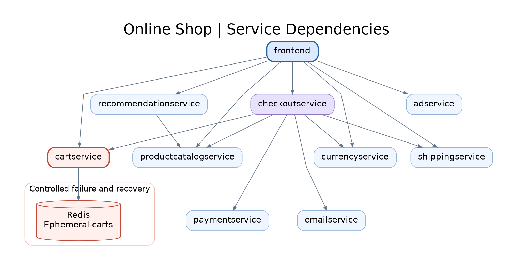
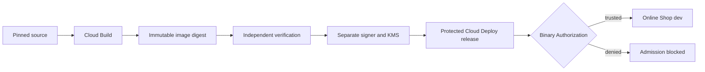

# Secure Delivery Platform

A Google-native trusted delivery platform for **Online Shop**: ten application services,
ephemeral Redis and a separately trusted OpenTelemetry Collector in dev. Independent
verification, signing and deployment authority remain separate; Binary Authorization
checks trusted digests at admission.

This repository contains implementation and **recorded acceptance**, not a live status page.
Nodes are paused. [Integration acceptance](docs/online-shop-acceptance.md) and
[draft v0.2.0 notes](docs/releases/v0.2.0.md) are under review in
[#133](https://github.com/DimitryZH/secure-delivery-platform/issues/133); no release is published
by this documentation. Sample-service is [retired](docs/sample-service-retirement.md).

## Architecture

Application call dependencies; cartservice and ephemeral Redis are highlighted as the
controlled incident scope. Arrows show client-to-service calls, not a strict execution
sequence. Only cartservice was scaled during the exercise; Redis was not stopped.
No load generator, assistant or packaging backend is part of this SDP composition.

See [Online Shop architecture](docs/architecture/online-shop.md) for the pinned runtime
contract, observability diagram and editable diagram sources. Online Shop is adapted from
[Google Online Boutique](https://github.com/GoogleCloudPlatform/microservices-demo) through
[Application Modernization Lab](https://github.com/DimitryZH/application-modernization-lab).

## Trusted delivery

Cloud Deploy consumes existing trusted artifacts; it does not rebuild on promotion.
Preflight checks independently reviewed evidence for eligibility, not permission to execute.
Every future action still requires fresh guards and its own authorization. Stage/prod Shop
progression, canary and executed rollback remain future work.

## Recorded delivery evidence

Recorded successful Online Shop rollouts include `shop-edge-66b636f-f8b585b4 / dev-edge-001`
on November 15, 2026. Screenshot captured November 17, 2026; account controls/navigation
were cropped from the publication copy. This is historical deployment evidence, not current
runtime availability or a reliability statistic. The aggregate 0% failure panel is not an
acceptance claim.

Recorded checks cover a protected 45-resource render, exact-digest runtime, one bounded
checkout with exact Redis-session cleanup, ten-service signals and six dashboard queries.
See [consolidated acceptance](docs/online-shop-acceptance.md) and the
[controlled incident record](monitoring/online-shop/incident-acceptance.md) for detection,
operator-confirmed failure notification, bounded recovery and incident closure. Email evidence
belongs with that record rather than a gallery in this README.

## Observability and accepted limits

OTLP traces/metrics and separately collected stdout logs retain service, environment, version
and release attribution. Scheduled HTTPS/synthetic checks and alert policies support the
recorded incident scenario. [Architecture](docs/architecture/online-shop.md#observability)
and [monitoring procedures](monitoring/online-shop/README.md) describe the signal paths.

- **429 verification deferred:** WAF SQLi/XSS 403 is confirmed, but neither the scoped throttle
  mechanism nor the real 1200/60s/IP threshold has a confirmed 429 in this environment.
- **Historical PromQL NO_DATA:** the original positive alert evaluation cannot be reconstructed
  from retained samples. No data is not zero errors or a passed query.
- Redis and Collector buffers are ephemeral. Recorded journeys and manual stop/resume do not
  prove sustained reliability, HA, lossless export or cold recovery.

A cold-recovery kit outside the GCP project and full cloud-resource removal are the
[next unexecuted stage](docs/online-shop-acceptance.md#next-stage-cold-recovery-and-full-cloud-removal--not-performed).
Neither is completed by a node pause or this documentation.

## Repository structure

| Area | Responsibility |
| --- | --- |
| `cloudbuild/` | Immutable builds, independent verification and separate signing |
| `deploy/` | Release contracts, rendering, preflight and bounded acceptance |
| `terraform/` | Infrastructure with isolated execution roots and explicit state ownership |
| `monitoring/` | Collector, dashboard, synthetic checks, alerts and incident procedures |
| `docs/` | Architecture, trust/access model, operating limits and recorded evidence |

## Documentation

- [Online Shop architecture](docs/architecture/online-shop.md)
- [Architecture overview](docs/architecture/overview.md) and [release model](docs/architecture/release-model.md)
- [Trusted delivery](docs/trusted-delivery.md) and [IAM model](docs/iam-model.md)
- [Complete workload deployment](deploy/online-shop/complete-README.md) and [HTTPS endpoint](deploy/online-shop/endpoint-README.md)
- [Operator runbook](docs/operator-runbook.md) and [environment policies](docs/architecture/environment-policies.md)
- [Observability](docs/observability.md) and [incident runbook](monitoring/online-shop/incident-runbook.md)
- [Acceptance checklist](docs/online-shop-acceptance.md), [draft release notes](docs/releases/v0.2.0.md) and [roadmap](docs/roadmap.md)
- [Architecture diagrams](docs/diagrams/README.md)
- [Historical controlled sample promotion](docs/trusted-delivery.md#controlled-promotion-validation)

One project/cluster and retained namespaces keep the platform small; namespace routing is not
strong IAM/RBAC isolation. Historical sample promotion is not proof of current Shop progression.
