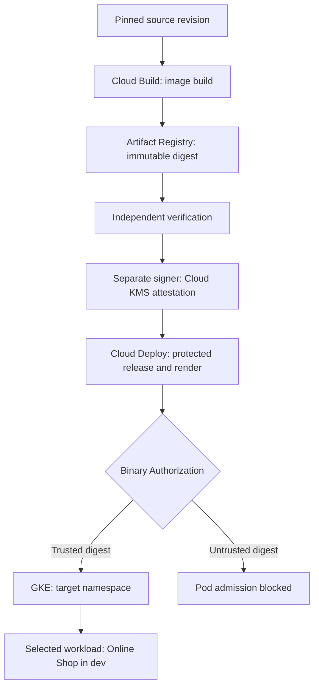
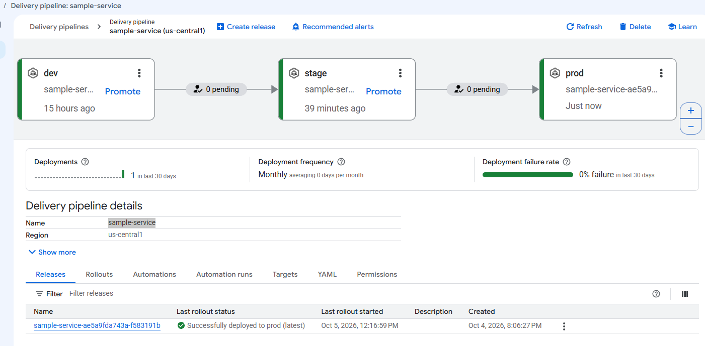
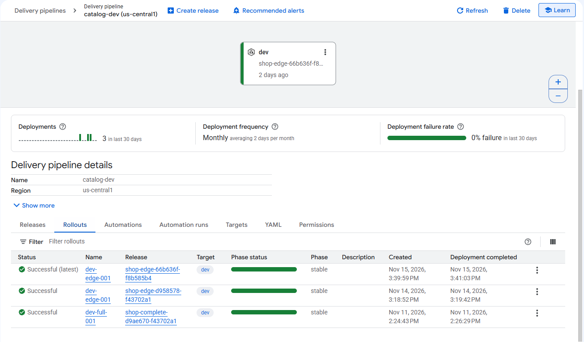

# Secure Delivery Platform

A delivery platform that connects immutable artifacts, independent verification, separate signing and controlled deployment to Kubernetes. Implemented on **Google Cloud**, it keeps build, signing and deployment authority separate and uses **Binary Authorization** to enforce digest-bound trust at admission.

The platform combines **Cloud Build, Artifact Registry, Cloud KMS, Cloud Deploy, GKE and Terraform**, with OpenTelemetry and Cloud Monitoring for operational visibility. Workloads exercise the platform: a small sample service established controlled promotion, and Online Shop extends the implementation to a microservices application.

## Explore the platform

| Documentation | What it covers |
| --- | --- |
| [Architecture overview](docs/architecture/overview.md) · [Diagrams](docs/diagrams/README.md) | Platform components and boundaries |
| [Release model](docs/architecture/release-model.md) · [Trusted delivery](docs/trusted-delivery.md) | Immutable artifacts, verification, signing and admission |
| [IAM model](docs/iam-model.md) · [Environment policies](docs/architecture/environment-policies.md) | Identities, permissions and target contracts |
| [Operator runbook](docs/operator-runbook.md) | Deployment and operational procedures |
| [Observability](docs/observability.md) · [Incident runbook](monitoring/online-shop/incident-runbook.md) | Signals, monitoring and recovery |
| [Integration acceptance](docs/online-shop-acceptance.md) · [Roadmap](docs/roadmap.md) | Recorded results, limitations and future scope |

## Platform capabilities

- **Immutable delivery:** pinned source revisions and image digests identify what is built and deployed; promotion reuses existing artifacts.
- **Independent trust checks:** verification and a separate KMS-backed signer establish digest-bound attestations before deployment.
- **Enforced admission:** Binary Authorization checks the required attestor before admitting application images.
- **Controlled deployment:** Cloud Deploy orchestrates releases with protected source/render artifacts and explicit preflight checks.
- **Infrastructure as code:** Terraform execution roots separate bootstrap, cloud foundation and Kubernetes state ownership.
- **Operational visibility:** attributed traces, metrics and correlated logs connect application behavior to a workload release; scheduled checks and alerts support incident response.

## Trusted delivery

Build, verification, signing and deployment are distinct stages. Cloud Deploy consumes existing trusted artifacts; it does not rebuild them during promotion. Preflight establishes deployment eligibility, while action authorization and target approval remain separate controls.

## Delivery lifecycle foundation — v0.1.0

The initial sample-service demonstrated the full **dev → stage → prod** controlled promotion path using the same verified and attested artifact, without rebuilding or replacing it.

This recorded execution established the platform's promotion workflow. The sample-service is now retired; the screenshot preserves historical delivery evidence and does not describe the current Online Shop topology.

[Historical validation](docs/historical/sample-service/README.md) · [Retirement scope](docs/sample-service-retirement.md)

## Microservices workload integration — v0.2.0

**Online Shop** exercises the platform with ten application services, ephemeral Redis and a separately trusted OpenTelemetry Collector. The application is adapted from [Google Online Boutique](https://github.com/GoogleCloudPlatform/microservices-demo) through [Application Modernization Lab](https://github.com/DimitryZH/application-modernization-lab).

Recorded integration covers trusted artifacts, a protected 45-resource deployment to **dev**, HTTPS with Cloud Armor WAF enforcement, a bounded checkout journey, ten-service telemetry and incident detection/recovery. Manual node stop/resume restored workload placement and Collector coverage automatically. Online Shop stage/prod progression remains future work.

Cloud Deploy records successful Online Shop rollouts to dev. This evidence complements the earlier sample-service promotion path; it does not establish Online Shop promotion to stage or prod.

[Service architecture and observability diagrams](docs/architecture/online-shop.md) · [Deployment guide](deploy/online-shop/complete-README.md) · [HTTPS endpoint](deploy/online-shop/endpoint-README.md) · [Incident and email evidence](monitoring/online-shop/incident-acceptance.md)

## Scope and operating state

Worker nodes are currently paused; screenshots and acceptance records describe completed executions rather than live availability. The platform is a portfolio implementation, with the following boundaries:

- Historical incident PromQL reconstruction returned no data; this is not interpreted as zero errors.
- Redis and Collector buffers are ephemeral. HA, sustained-load reliability and executed release rollback are not claimed.
- Namespace routing is not strong IAM/RBAC isolation. Cold recovery and full cloud-resource removal are planned separately.

See the [acceptance record](docs/online-shop-acceptance.md) for evidence and detailed limits.

## Repository structure

| Area | Responsibility |
| --- | --- |
| `cloudbuild/` | Image builds, verification and separate signing |
| `deploy/` | Release contracts, rendering, preflight and deployment acceptance |
| `terraform/` | Infrastructure and explicit state ownership |
| `monitoring/` | Collector, dashboards, scheduled checks, alerts and incident procedures |
| `docs/` | Architecture, access model, operations and recorded evidence |
