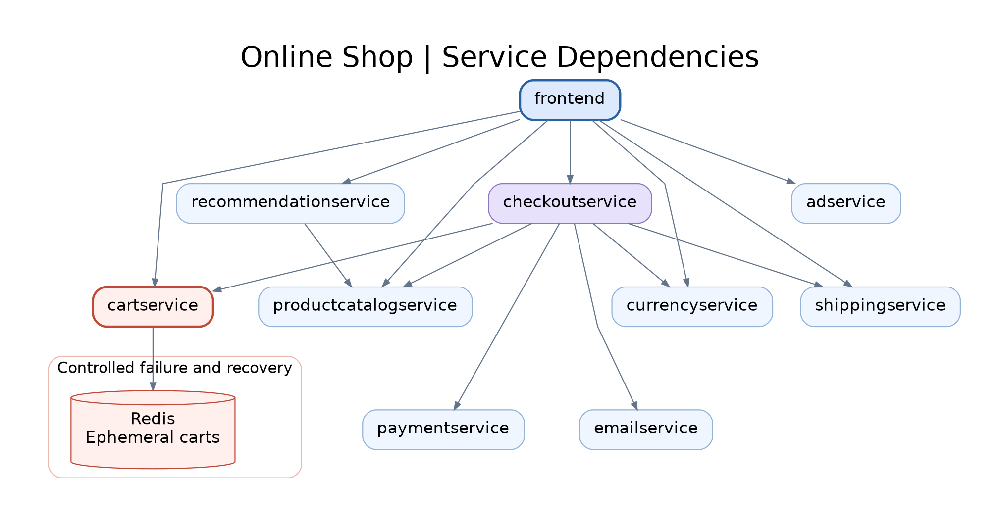
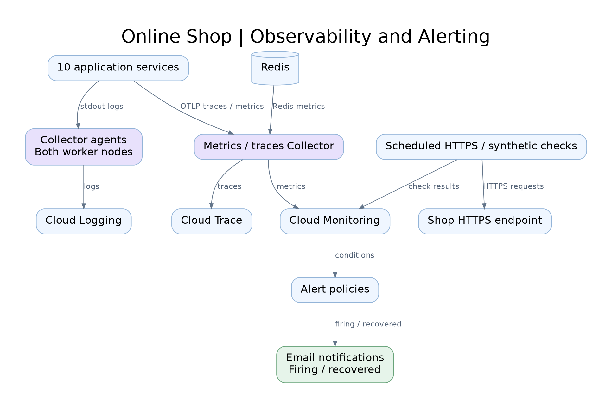

# Online Shop architecture

These diagrams describe the reviewed dev composition, not a new live check. The portable
application contract is pinned to Application Modernization Lab revision
[`67b6cd85ae01c698bbf86904d953d5145b7b5820`](https://github.com/DimitryZH/application-modernization-lab/blob/67b6cd85ae01c698bbf86904d953d5145b7b5820/workloads/online-shop/docs/RUNTIME.md).
SDP's [complete workload profile](../../deploy/online-shop/complete-README.md) supplies the
platform settings. The accepted application derives from Google Online Boutique; existing
[upstream attribution](https://github.com/DimitryZH/application-modernization-lab/tree/67b6cd85ae01c698bbf86904d953d5145b7b5820/workloads/online-shop) remains unchanged.

## Service dependencies

Application call dependencies; cartservice and ephemeral Redis are highlighted as the
controlled incident scope. Arrows show client-to-service calls, not a strict execution
sequence. The incident scaled only cartservice 1 -> 0 -> 1; Redis was not an injected failure.
No load generator, assistant or packaging backend is part of the deployed SDP composition.

[SVG](../images/online-shop/service-dependencies.svg) ·
[Graphviz source](service-dependencies.dot) · [Mermaid source](service-dependencies.mmd).
The PNG/SVG exports were rendered with Graphviz; Mermaid expresses the same call relationships.

## Observability

Logical signal paths, not every exporter, receiver or infrastructure component. Application
stdout logs are collected separately from OTLP traces/metrics. No Redis SERVER spans are
claimed. Collector agents cover both worker nodes when running; the diagram does not imply
current availability while nodes are paused. The firing/recovered email labels describe
notification paths; the incident record contains one matching operator-supplied email pair,
not a notification-delivery guarantee.

[SVG](../images/online-shop/observability.svg) ·
[Graphviz source](observability.dot) · [Mermaid source](observability.mmd).
See [monitoring](../../monitoring/online-shop/README.md),
[scheduled correlation](../../monitoring/online-shop/scheduled-correlation.md) and
[incident acceptance](../../monitoring/online-shop/incident-acceptance.md) for native correlation,
notification evidence and the unknown exact email receipt time.

## Evidence boundaries

[Consolidated acceptance](../online-shop-acceptance.md) binds recorded runtime, journey,
telemetry, incident and repeated stop/resume results to their releases. **429 verification is
deferred** and **historical PromQL NO_DATA** remains an accepted reconstruction limitation.
Diagrams and screenshots do not establish continuous reliability or erase either limit.
The [cold-recovery kit and full removal stage](../online-shop-acceptance.md#next-stage-cold-recovery-and-full-cloud-removal--not-performed)
is future work. No cloud operation or restart accompanies this visual documentation.
