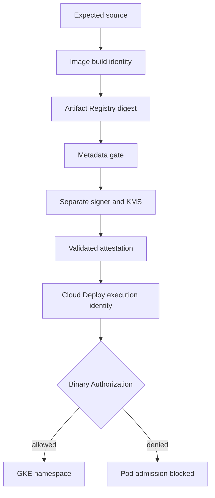
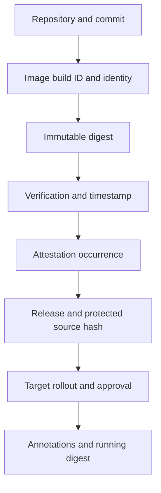
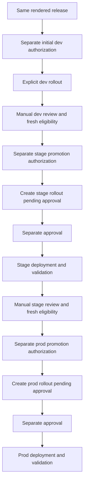
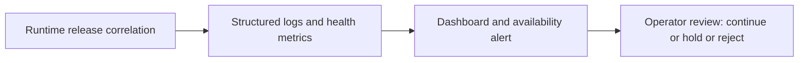
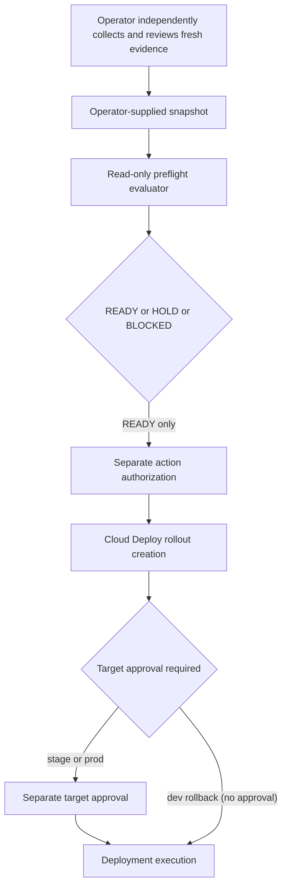

# Architecture Diagrams

Visual summaries of [Architecture Overview](../architecture/overview.md), [Release Model](../architecture/release-model.md), [Environment Policies](../architecture/environment-policies.md), and [IAM Model](../iam-model.md), without redefining contracts.

## Trusted delivery

Cloud Build executes distinct jobs; shared execution service does not combine authority. Orchestration precedes admission.

## Identity correlation

Rollout state changes; artifact identity does not. Release Model owns field mapping.

## Controlled promotion

All targets share admission. Render-all is not rollout-all; approval is separate from promotion. Failure means stop; rollback is not automatic. See [Controlled Promotion Validation](../trusted-delivery.md#controlled-promotion-validation).

## Operational visibility and review

These implemented [Observability](../observability.md) capabilities have bounded live validation. A real firing incident and broader performance validation were not completed. Automated decisions remain deferred.

## Evidence-snapshot preflight

The preflight evaluates a fresh, independently reviewed, operator-supplied evidence snapshot. It does not collect cloud data, authorize, or execute an action. Review, eligibility, action authorization, target approval, and execution remain separate boundaries; READY is eligibility only. HOLD or BLOCKED stops progression. Promotion READY and retention-driven BLOCKED were live-validated read-only; rollback eligibility and other decision scenarios have offline-only coverage. Initial dev rollout uses its separate manual review procedure. Automated promotion and rollback remain deferred.
