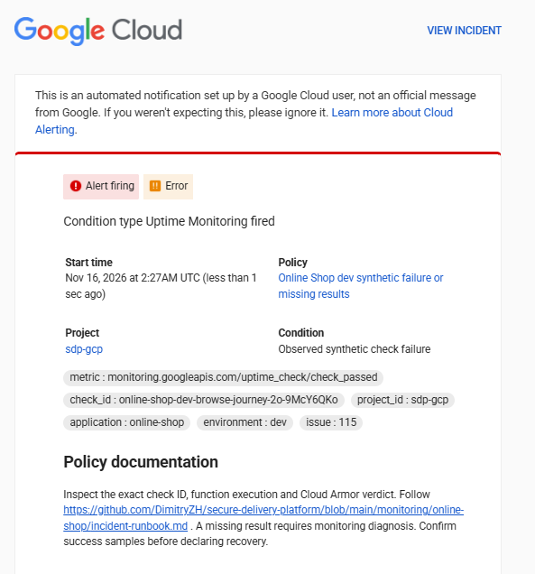
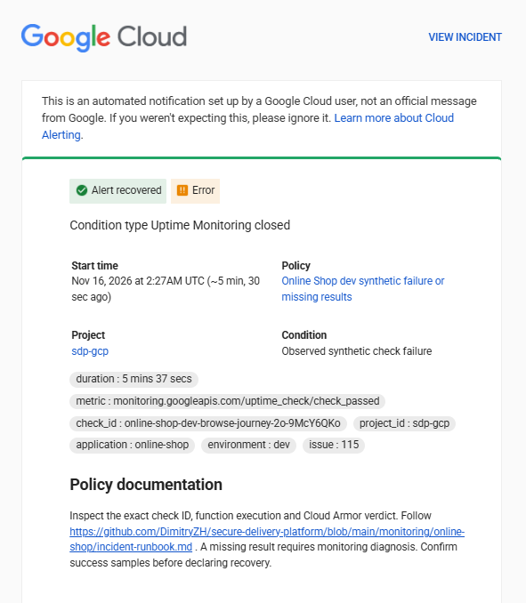

# Recorded dev incident exercise (#115)

This record describes one authorized cart dependency failure on **2026-11-15 America/Toronto
(2026-11-16 UTC)**. It is evidence for that execution, not continuous availability or current
health. The [runbook](incident-runbook.md) remains the execution contract; raw responses,
traces, screenshots, session material and operator details remain private.

## Reviewed identity and scope

- Active release binding: `sdp-dev-v1`; target `catalog-dev -> dev`.
- Application release: `shop-edge-66b636f-f8b585b4`, rollout `dev-edge-001`.
- Release set: `sha256:f8b585b4334eddb2a7e4962ca54bfbdbc7fb96e7751083c57d3d3924f7459f25`.
- Producing/deployment revision: `66b636f074ac9270a5b2617d27d3261ce0ec1872`;
  validator revision: `76aba4273028a076d29463104af211bef2763983`.
- Only `dev/Deployment/cartservice` replicas changed **1 -> 0 -> 1**, once. Original
  Deployment UID, Pod template and immutable image digest were verified and preserved.
- The operator confirmed a checked, independently authenticated recovery session before
  injection. No HPA, active rollout or relevant maintenance snooze was present. Both nodes,
  all 14 Shop Pods, both Collector agents, HTTPS and scheduled checks passed the baseline.

## Sanitized UTC timeline

| Event | 2026-11-16 UTC | Evidence/outcome |
| --- | --- | --- |
| Shared T0 / guarded scale0 | 02:25:45 / 02:25:45.345703 | One successful scoped mutation |
| Scheduled failure | 02:26:01.709845 | Execution `11a8d9f87949cf4c49003c458a7bee24`: catalog step, one GET |
| Synthetic incident opened | 02:27:30 | `0.of2n3774glet` |
| Recovery started | 02:27:36.376406 | Approximately 111.4 seconds after T0; no wait for email |
| Frontend error incident opened | 02:27:47 | `0.of2n3fl06tr9` |
| Cart Ready/Available | 02:28:06.503394 | Approximately 141.5 seconds after T0; replicas=1 |
| Successful scheduled journey | 02:31:03.553570 | Execution `f10fe9da97381429054fecea40f8e8cc`: three GETs, HTTP 200 |
| Frontend incident closed | 02:32:09 | Actual API readback |
| Synthetic incident closed | 02:33:08 | Actual API readback after successful scheduled results |
| Firing email received | **02:27 (minute precision)** | Operator-reported mailbox time: Nov 15, 21:27 America/Montreal (EST, UTC-05:00) |
| Recovered email received | **02:33 (minute precision)** | Operator-reported mailbox time: Nov 15, 21:33 America/Montreal (EST, UTC-05:00) |

The email screenshot's 02:27 UTC value is the alert start minute, **not** the receipt timestamp.
The operator supplied matching firing and recovered emails for the same synthetic policy/check.
Mailbox receipt times were subsequently supplied by the operator: **2026-11-15 21:27 and
21:33 America/Montreal (EST, UTC-05:00)**, equivalent to **2026-11-16 02:27 and 02:33 UTC**.
The UTC timeline uses the latter. Mailbox display precision is one minute; seconds and exact
delivery latency are unknown. The shared 02:27 minute does not make alert start and receipt
the same event. Delivery was an acceptance outcome, not a prerequisite for starting the exercise.

## Recorded synthetic firing and recovered emails

| Alert firing | Alert recovered |
| --- | --- |
|  |  |

Recorded synthetic firing and recovery notifications during the controlled cartservice outage
on November 16, 2026. Both show project `sdp-gcp`, policy **Online Shop dev synthetic failure or
missing results**, check `online-shop-dev-browse-journey-2o-9McY6QKo` and start 02:27 UTC.
The recovered email displays **5 mins 37 secs**: this is the alert duration, not application
outage duration or email delivery latency. The operator supplied the pair and mailbox receipt
minutes recorded above. Alert event timestamps and mailbox receipt times remain separate;
no second-level receipt precision or exact delivery latency is inferred.

The supplied publication images contain no mailbox/account controls or recipient address.
No email was reconstructed and no frontend-warning notification is substituted. Successful
scheduled results and incident API closure remain independent recovery evidence in the timeline.

## Failure, recovery and cleanup evidence

The failed trace contains frontend `CartService/GetCart` CLIENT error `Unavailable`, followed
by frontend `GET /` SERVER HTTP 500. Thirteen native-linked application logs and eleven spans
retain source/version/release/digest attribution. Cart SERVER spans are absent as expected with
zero cart Pods. Cart-dependent frontend failure was the intended degradation; non-cart Pod
UIDs/images/readiness, both nodes, Collector and HTTPS health retained their baseline.

Both synthetic and frontend-error policies opened real incidents. A raw frontend server-error
counter is positive. Dashboard desired/available cart replica histories show **1 -> 0 -> 1**;
desired=0 is an outage signal, not healthy absence.

Recovery started before four minutes and restored Ready/Available before eight minutes.
Post-recovery independent runtime acceptance passed with all 14 Pods, two nodes, Collector 2/2
and exact image digests. TLS and the frontend backend were healthy. The naturally scheduled
recovery execution passed the merged `diagnose-scheduled.py --armor-mode preview` check:
function/client/frontend W3C parenting, native logs, release attribution and three unique
same-source/backend edge matches. This was not a manually invoked synthetic or a new checkout.

Exact derived Redis session keys for **both** failed and recovered executions returned
`EXISTS=0`. The browse monitor performed no Redis writes, so no DEL was necessary; other keys
were untouched. The scoped operator-owned port-forward was closed. Cloud Armor stayed in
preview; no other workload, capacity, IAM, Terraform, build, signing or rollout change occurred.

## Accepted scope and limits

**Passed for review:** one bounded failure, detection, actual notification receipt, native
trace/log diagnosis, guarded recovery, successful scheduled results, incident closure and
exact-session/forward cleanup.

**Not confirmed:** a later historical range query of the exact frontend-alert PromQL returned
**no data** and did not reconstruct its positive evaluation. This is not zero errors and is not
a successful PromQL check. The actual OPEN/CLOSED incident, positive raw counter and HTTP 500
trace remain separate positive evidence. The query discrepancy's cause is unresolved; no extra
traffic was generated to force a result. The later documentation review explicitly accepts this bounded reconstruction limitation;
that disposition does not turn this historical query check into a pass.

This exercise does not prove continuous reliability, load/HA behavior, lossless export, Redis
durability, notification delivery guarantees or Armor enforcement. The one-injection authorization was
consumed; another injection requires new authorization.

## Historical checkpoint and subsequent review

The [roadmap](../../docs/roadmap.md#online-shop-integration) and
[baseline gates](../../docs/platform-baseline-recovery.md) remain authoritative.

| Gate at the incident checkpoint | Status and required evidence |
| --- | --- |
| Armor enforcement acceptance | Pending. This execution validated preview only. Review the active environment's preview results and a separate full enforcement plan/apply, then bounded allowed traffic and attributed WAF 403/rate 429 results. Distinguish the actual priority-2000 1200/60s/IP threshold from a temporary scoped mechanism test; do not reuse another environment's historical proof. |
| Repeated manual stop/resume with permanent selectors | Pending. Confirm monitoring maintenance handling before a separately authorized cycle, preserve artifacts/state, then demonstrate automatic placement of application workloads on their pool and Collector 2/2 without ad hoc eviction/cordon, followed by runtime/HTTPS/scheduled readiness. No lifecycle schedule is introduced. |
| Final documentation and release review | Pending. Review/merge this evidence, reconcile all mandatory active-binding acceptance records, explicitly disposition the historical PromQL no-data limit, align canonical operating/security/cost limits and review v0.2.0 release notes. Publication/tagging is a separate action after milestone acceptance. |

No milestone/issue closure or platform release is performed by this documentation update.
The current roadmap defines subsequent delivery and lifecycle scope; this historical
incident record adds no future completion requirements.

Later checkpoint: [the repeated manual stop/resume passed recorded acceptance](../../docs/online-shop-acceptance.md).
The [PromQL read-only analysis](promql-incident-limit.md) explains the retained constant-counter
replay while preserving the unconfirmed historical positive evaluation. Final review
[#133](https://github.com/DimitryZH/secure-delivery-platform/issues/133) is complete and
[platform v0.2.0](https://github.com/DimitryZH/secure-delivery-platform/releases/tag/v0.2.0) is published;
WAF enforcement subsequently passed; 429 verification and historical PromQL reconstruction
are explicitly accepted limitations in the [consolidated review](../../docs/online-shop-acceptance.md).
Earlier checkpoint statuses above are historical.
